# Leakage-Free Diabetic Retinopathy Grading

Reproduction of 10 diabetic-retinopathy (DR) models from a 15-paper literature survey, plus a validation-selected
ensemble for **five-class ICDR severity grading** (No DR, Mild, Moderate, Severe, Proliferative DR).

Everything is in PyTorch and uses only genuine fundus photographs with their original grades: no synthetic or GAN
images and no generated labels. Hyperparameters, ensemble members and grade thresholds were all fixed on validation
data. Each test split was then evaluated **exactly once**.

**Authors:** Akshai Krishna KP, Mohammed Azhar Sait, Karthik Krishna K, Rohit A.

| Read this | What it is |
|---|---|
| [`notebooks/DR_full_pipeline.ipynb`](notebooks/DR_full_pipeline.ipynb) | **The whole project, step by step, in one notebook**: every stage in order, with explanations and outputs |
| [`paper/main.pdf`](paper/main.pdf) | IEEE-format paper (14 pages) |
| [`reports/final_report.md`](reports/final_report.md) | Complete results, discussion and limitations |
| [`reports/replication_guide.md`](reports/replication_guide.md) | Every command, with the reason for each decision |
| [`docs/literature_survey.pdf`](docs/literature_survey.pdf) | The 15-paper survey the models were taken from |
| [Release v1.0](https://github.com/nik1856nik/leakage-free-dr-grading/releases/tag/v1.0) | Trained ensemble weights (4 × `.pt`) + checksums |

---

## Headline results

| APTOS 2019 test (n = 525, evaluated once) | Value [95% bootstrap CI] |
|---|---|
| Accuracy | **0.846** [0.815–0.874] |
| Quadratic weighted kappa (QWK) | **0.931** [0.913–0.947] |
| Macro-F1 | 0.683 [0.626–0.734] |
| Referable DR (grade ≥ 2) | sensitivity **0.961** · specificity **0.919** · AUC **0.984** |

| External dataset (never used for training or selection) | Accuracy | QWK | Referable-DR AUC (sens / spec) |
|---|---|---|---|
| IDRiD (508 images) | 0.593 | 0.819 | 0.976 (0.81 / 0.995) |
| Messidor-2 (1,740 images) | 0.661 | 0.725 | 0.948 (0.45 / 0.995) |

---

## Datasets (official sources)

| Dataset | Images | Role here | Official source |
|---|---|---|---|
| **APTOS 2019 Blindness Detection** | 3,662 | train / validation / test | [Kaggle competition](https://www.kaggle.com/competitions/aptos2019-blindness-detection) |
| **EyePACS** (Kaggle Diabetic Retinopathy Detection, 2015) | 35,126 | pretraining, cross-dataset | [Kaggle competition](https://www.kaggle.com/competitions/diabetic-retinopathy-detection) |
| **IDRiD** (Indian Diabetic Retinopathy Image Dataset) | 516 | external test | [IEEE DataPort](https://ieee-dataport.org/open-access/indian-diabetic-retinopathy-image-dataset-idrid) |
| **Messidor-2** | 1,748 | external test | Images: [ADCIS](https://www.adcis.net/en/third-party/messidor2/) (licence form) · Grades: [Kaggle `google-brain/messidor2-dr-grades`](https://www.kaggle.com/datasets/google-brain/messidor2-dr-grades) |

The datasets are **not** included in this repository; their licences forbid redistribution. See
[`reports/dataset_status.md`](reports/dataset_status.md) for the download steps.

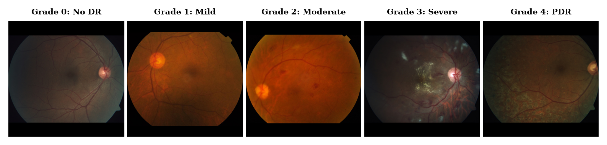

---

## Method

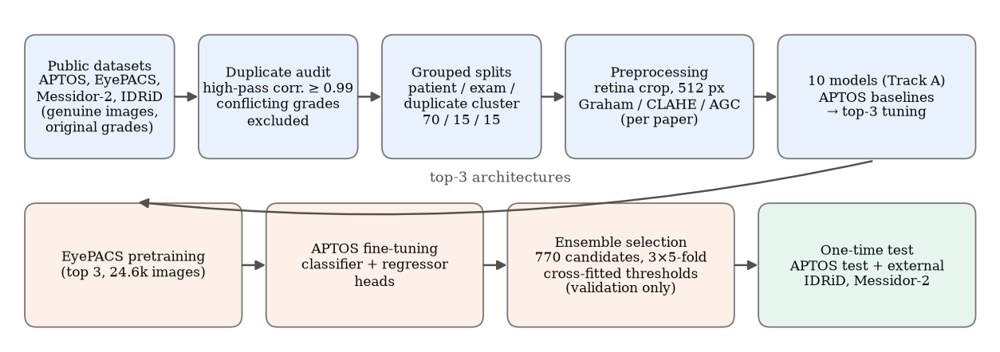

1. **Duplicate audit (leakage control).**
   - Near-duplicate photos are found by green-channel high-pass correlation inside the retina, at r ≥ 0.99.
   - Copies with conflicting grades are excluded: 79 images in APTOS and 4 in IDRiD.
   - Same-grade copies are collapsed to one image.
2. **Grouped splits.** The split is 70/15/15, stratified, seed 42, and grouped:
   - by patient for EyePACS;
   - by exam for Messidor-2;
   - by duplicate cluster for APTOS.

   No group crosses two splits. IDRiD keeps its official test set.
3. **Stage A, 10 paper baselines.** Each model uses paper-derived settings with shared splits and metrics.
   The selection score is S = ½(QWK + macro-F1).
4. **Stage B, tuning the top 3.** One factor is changed at a time, and every change is compared against the
   run-to-run seed noise.
5. **Stage D, EyePACS pretraining** of the top 3 architectures.
6. **Stage E, APTOS fine-tuning** with two head types:
   - a **classifier**;
   - an ordinal **regressor** (SmoothL1 loss on the grade value).
7. **Stage F, ensemble selection.**
   - 770 candidates: every 1–4-model subset under two decision rules.
   - Each candidate is scored with **3 × 5-fold cross-fitted grade thresholds** on validation only.
8. **Stage G, one test evaluation.** APTOS test is scored once, plus IDRiD and Messidor-2 as external
   datasets.

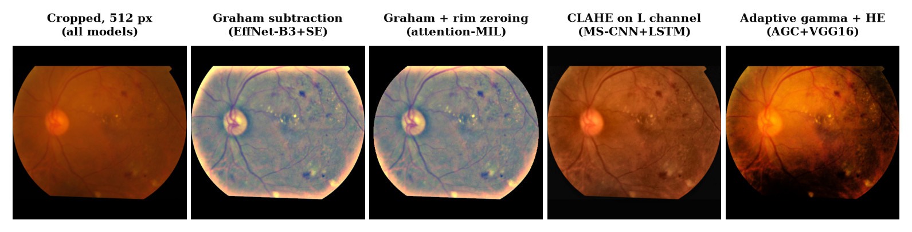

### The selected ensemble

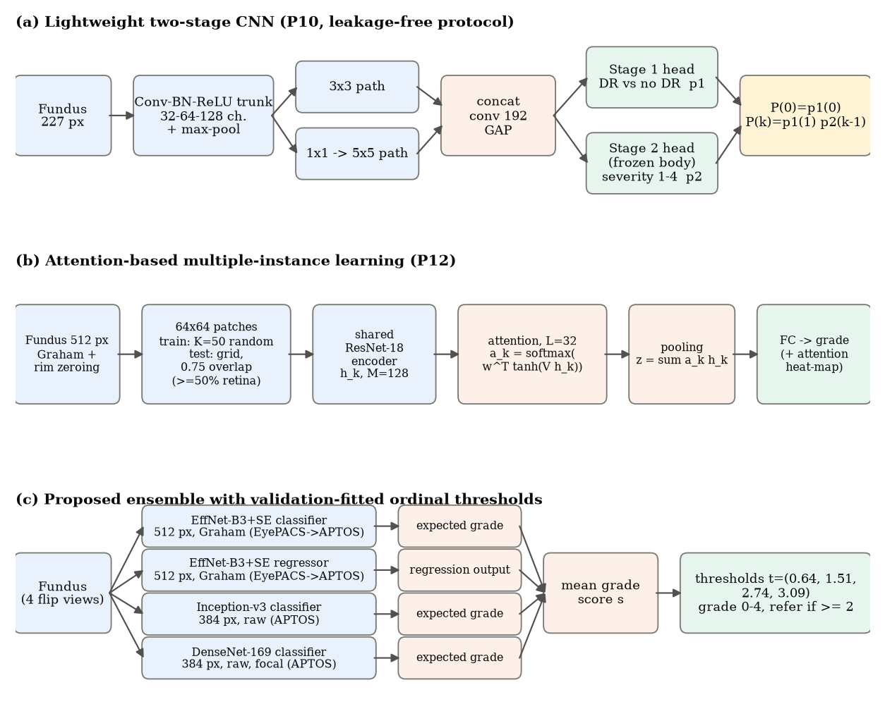

| Member | Initialisation | Input |
|---|---|---|
| EfficientNet-B3 + SE, classifier | EyePACS-pretrained, fine-tuned on APTOS | 512 px, Ben Graham |
| EfficientNet-B3 + SE, regressor | EyePACS-pretrained, fine-tuned on APTOS | 512 px, Ben Graham |
| Inception-v3, classifier | ImageNet → APTOS | 384 px, raw |
| DenseNet-169, classifier, focal loss | ImageNet → APTOS | 384 px, raw |

How a prediction is made:
- Each member's grade score is averaged over 4 flipped views.
- The four scores are averaged.
- The average is cut at thresholds **0.64 / 1.51 / 2.74 / 3.09**, which were fitted on validation.

The total size is 56.3 M parameters and about 174 ms per image.

---

## Results and figures

### All reproduced models on APTOS test
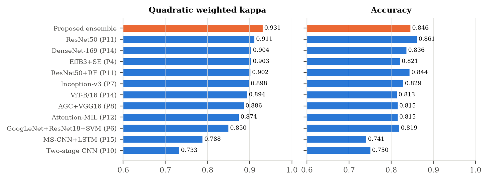

The full table, with every metric and external IDRiD columns, is in [`reports/model_comparison.csv`](reports/model_comparison.csv).

### Confusion matrix and referable-DR ROC (APTOS test)
| | |
|---|---|
| 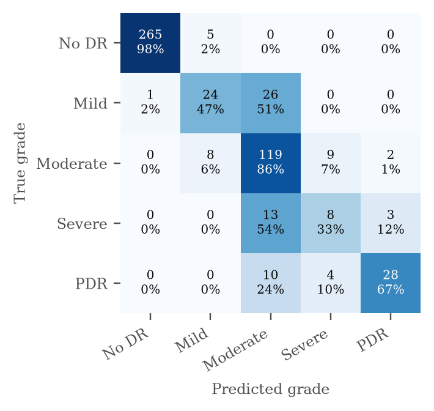 | 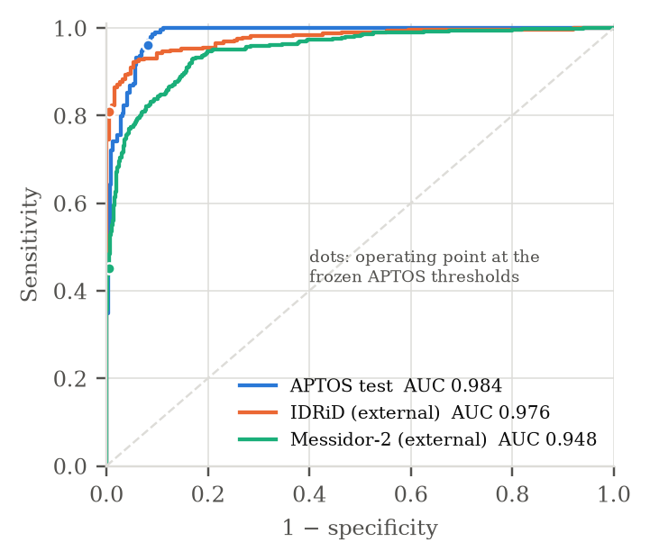 |

### External datasets
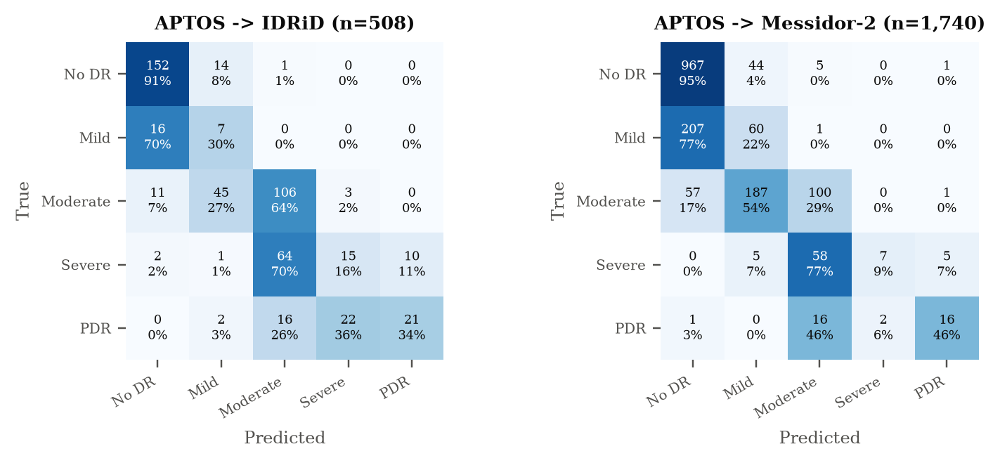

### Ensemble selection and per-class performance
| | |
|---|---|
| 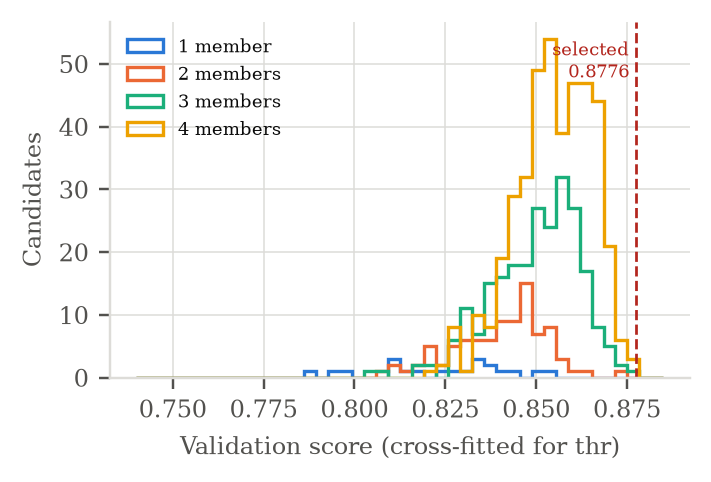 | 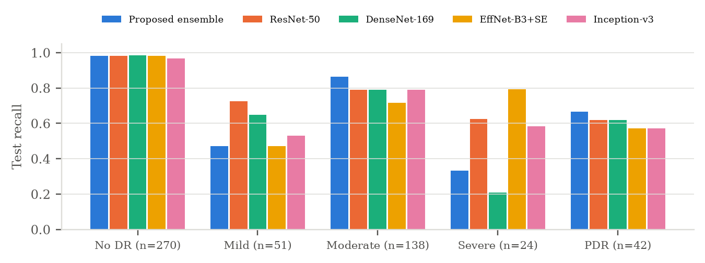 |

### Duplicate audit
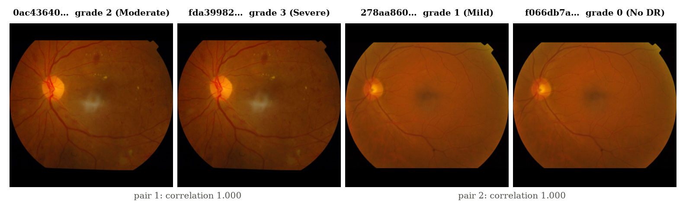

### Interpretability (Grad-CAM, EfficientNet-B3 member)
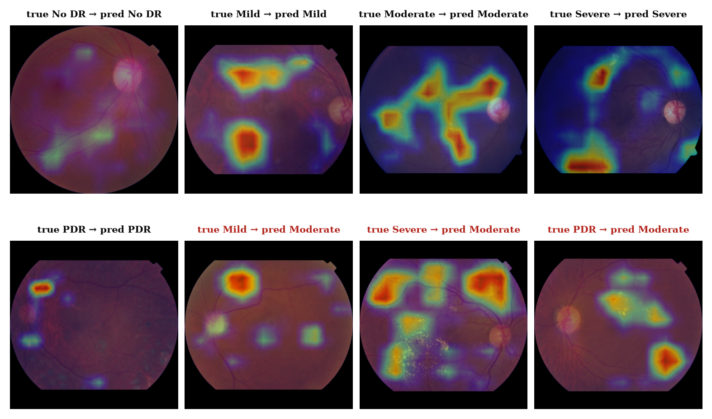

---

## Observations

1. **The ensemble ranks highest on QWK, but its lead over the best single model is not significant.**
   - The ensemble scores QWK 0.931; ResNet-50, the best single model, scores 0.911.
   - On exact accuracy ResNet-50 is slightly higher (0.861 vs 0.846).
   - McNemar's test shows no significant difference (28 vs 36 discordant images, p = 0.38).
   - The ensemble is kept because it was selected by the pre-declared validation rule. Switching after seeing
     test results would be selection on the test set.
2. **Tuning tweaks barely matter.**
   - Resolution, preprocessing, focal loss and balanced sampling all changed the validation score by ±0.017 or
     less.
   - That is close to the seed noise (±0.005 std).
   - Pretraining on more data, combined with ensembling different heads, was the lever that worked.
3. **Referable-DR screening is strong in-domain.**
   - Sensitivity is 0.961 and AUC 0.984 on APTOS test.
   - All "No DR" vs "any DR" decisions are near-perfect.
   - Most errors are between **neighbouring grades**, especially Mild or Severe predicted as Moderate. These
     boundaries are also hard for human graders.
4. **A new site shifts calibration more than discrimination.**
   - On Messidor-2 the APTOS ensemble still ranks well (referable AUC 0.948).
   - At the APTOS thresholds, however, it is far too conservative: referable sensitivity is only 0.45.
   - **EyePACS-trained** models transfer much better (EffB3+SE: AUC 0.967, sensitivity 0.92), so training data
     diversity matters more than architecture.
   - Any clinical use would need per-site threshold recalibration.
5. **Leakage control is necessary.**
   - APTOS contains 148 near-duplicate pairs, and 79 images had conflicting grades.
   - Without grouping, copies of the same photo can land in both train and test, which inflates the scores.
6. **Several published models fall well short under a clean protocol.**
   - The lightweight two-stage CNN (P10) reaches QWK 0.733, and MS-CNN+LSTM (P15) reaches 0.788.
   - The strong numbers in their papers do not carry over to leakage-free grouped splits.

---

## Repository structure

```
.
├── notebooks/
│   ├── DR_full_pipeline.ipynb   # the whole project, in order, with explanations and outputs
│   └── build_notebook.py        # generates the notebook (plain-Python source of its cells)
├── configs/                     # per-paper model defaults (models.yaml), dataset and training notes
├── src/                         # library code
│   ├── preprocessing/retina.py  # retina crop, Ben Graham, CLAHE, AGC (P8)
│   ├── datasets/                # dataset sources + FundusDataset
│   ├── models/zoo.py            # the 10 reproduced architectures
│   ├── training/engine.py       # training loop (AMP, CE / focal / regression heads)
│   ├── evaluation/              # metrics, bootstrap CIs, plots
│   └── ensemble/                # score averaging, thresholds
├── scripts/                     # entry points: data prep, training queues, selection, evaluation, predict.py
├── data/
│   ├── splits/                  # train/val/test assignment per image (IDs + original grades)
│   └── metadata/                # duplicate-audit clusters and pairs
├── experiments/                 # per-run config, history, summary, predictions; best_aptos/ = final selection
├── results/plots/               # per-run, comparison and best-model figures
├── reports/                     # final report, replication guide, literature analysis, CSV tables
├── best_model/model_card.json   # ensemble definition (weights: GitHub release v1.0)
├── paper/                       # LaTeX source, figures, compiled PDFs
├── docs/literature_survey.pdf
├── pyproject.toml, uv.lock      # uv-managed environment
└── README.md
```

---

## Setup

Requires Python 3.12 and an NVIDIA GPU with CUDA 12.8. The work was done on an RTX 4060 Laptop with 8 GB.

```bash
git clone https://github.com/nik1856nik/leakage-free-dr-grading.git && cd leakage-free-dr-grading
uv sync                                   # torch 2.11 (cu128), timm, scikit-learn, grad-cam, jupyter ...
gh release download v1.0 -D best_model    # trained weights
(cd best_model && sha256sum -c SHA256SUMS.txt)
```

### Grade new images
```bash
uv run python scripts/predict.py path/to/fundus.jpg more_images/ --csv predictions.csv
```
For each image the output gives:
- the grade (0–4) and its name;
- the continuous grade score;
- P(referable), with a REFER flag;
- the five class probabilities.

It applies the exact training pipeline. It was checked to reproduce the evaluated test grades exactly (40/40).
**Research use only. This is not a medical device.**

### Walk through the whole project
```bash
uv run jupyter lab notebooks/DR_full_pipeline.ipynb
```
- By default the notebook reads the saved results and recomputes every analysis, which takes a few minutes.
- Each training stage has a switch at the top (`RUN_BASELINES = True`, and so on) that re-runs it with the exact
  project command.

### Reproduce from scratch (command line)
```bash
bash scripts/download_datasets.sh
uv run python scripts/prepare_data.py --datasets idrid messidor2 aptos eyepacs   # cache, duplicate audit, splits
bash scripts/run_queue.sh                                # Stage A: 10 baselines (validation)
bash scripts/tune_queue.sh && bash scripts/tune_round2.sh   # Stage B: top-3 tuning (validation)
bash scripts/run_eyepacs.sh                              # Stage D: EyePACS pretraining (first 4 runs)
bash scripts/run_best.sh                                 # Stages E+F: fine-tunes + ensemble selection (validation)
uv run python scripts/best_model.py --dataset aptos --final --external idrid messidor2   # Stage G: ONE test evaluation
uv run python scripts/best_report.py --dataset aptos --external idrid messidor2
uv run python scripts/final_baselines.py                 # Stage H: baselines on test
uv run python scripts/compare_models.py --split test
```
See [`reports/replication_guide.md`](reports/replication_guide.md) for every command and the reason behind it.

---

## Licence and data terms
The datasets and their grades remain under their providers' terms:
- APTOS and EyePACS: Kaggle competition rules.
- IDRiD: CC BY 4.0.
- Messidor-2: ADCIS licence.

The trained weights were derived from APTOS and EyePACS and are shared for research use only.
